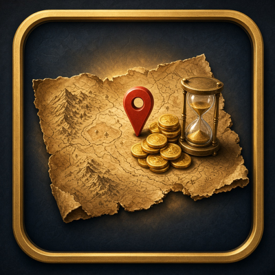

# GoldPerSpot (WoW: Forever) v0.1.0

*Formerly "FarmTracker" in [wow-forever-addons](https://github.com/masterred92/wow-forever-addons). It was renamed because several addons on CurseForge already use "FarmTracker".*

Tracks a farming session and shows, in a small movable frame:
- spot name and session time
- total value and **gold per hour**
- coin looted
- the top 5 items by value (`(v)` = valued at vendor price)
- a verdict such as `this spot: 3.2g/hr vs your best 4.5g/hr (Westfall boars)`. Under 75% of your best it adds "consider <best spot>"; beating it shows "NEW BEST".

How it counts:
- **Items:** it compares your bags before and after, so skinning, herbs and loot all count in any language. Changes while a vendor, mailbox, bank, trade or AH window is open are ignored, so purchases and mail don't count. Bag changes during combat are counted when combat ends.
- **Coin:** only money gained while a loot window is open (not quest rewards or sales).
- **Value:** your newest AH scan price (PriceLog or MatTooltip) minus the 5% AH cut, or the vendor price if there's no scan. `/goldspot value vendor` forces vendor prices.
- **History:** sessions of 1 minute or more are saved per spot (up to 50 each). Only sessions of 5 minutes or more count as a "best".

Read-only: it never loots, clicks or moves for you.

## Download
- **CurseForge:** https://www.curseforge.com/wow/addons/goldperspot (first release coming at launch, Nov 4). Author: [MasterRed92](https://www.curseforge.com/members/masterred92/projects).
- **Wago Addons:** https://addons.wago.io/addons/goldperspot (first release coming at launch, Nov 4).
- **GitHub:** [Releases](https://github.com/masterred92/GoldPerSpot/releases) (coming with the first tagged release) · [Issues](https://github.com/masterred92/GoldPerSpot/issues)
- **Companion addons** (optional, they share AH scans): [NeutralFlip](https://github.com/masterred92/NeutralFlip) · [PriceLog](https://github.com/masterred92/PriceLog) · [MatTooltip](https://github.com/masterred92/MatTooltip)

## Commands
Alias: `/kspot`.
`/goldspot start [spot name]` (default: the zone name) · `pause` / `resume` · `stop` · `show` / `hide` · `lock` · `resetpos` · `history` · `value ah|vendor` · `report` · `reset confirm`
The frame has Start, Pause, Stop and Bug (report) buttons.

## Install
1. Download the addon zip (see Download above) or clone this repo into a folder named `GoldPerSpot`.
2. Put the addon folder (`GoldPerSpot`) in `World of Warcraft\_forever_\Interface\AddOns\`. That folder sits next to `_retail_`; the exact name may differ.
3. Restart the game, or type `/reload`. Check it is ticked in the AddOns list on the character screen.

## In-game test checklist
1. The frame appears at the left middle of the screen, doesn't overlap the minimap, quest tracker or Polestar, and can be dragged; its position survives `/reload`.
2. Click Start, then skin 5 beasts and pick 5 herbs: the item counts match what entered your bags.
3. Loot coin from a mob: Coin goes up. Hand in a quest with a gold reward: Coin does **not** change.
4. Buy something from a vendor during a session: it is **not** counted.
5. Loot during combat: it's counted once combat ends, with no errors or "action blocked".
6. Pause, loot something, Resume: the paused loot is not counted and the timer stopped while paused.
7. With PriceLog or MatTooltip scan data, mats show AH value (no `(v)`). Without a scan, they show `(v)`.
8. Stop after 5 or more minutes, farm a second spot, and check the verdict line compares the two. `/goldspot history` lists both.
9. `/goldspot report` or the Bug button: a copyable report opens.
10. In the AddOns list (character select or Esc > AddOns), GoldPerSpot shows its icon. If it shows a blank or green square, report it; the addon still works.

## Development
`tests/run.sh [path-to-wow-ui-source-forever]` runs `luac -p`, luacheck, the mock-client tests and (with a path) the API check against Blizzard's UI source. GitHub Actions runs the same on every push. Releases are packaged by [BigWigsMods/packager](https://github.com/BigWigsMods/packager) only when a `v*` tag is pushed.
